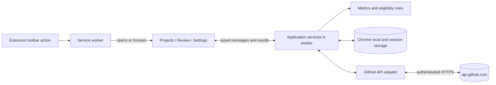
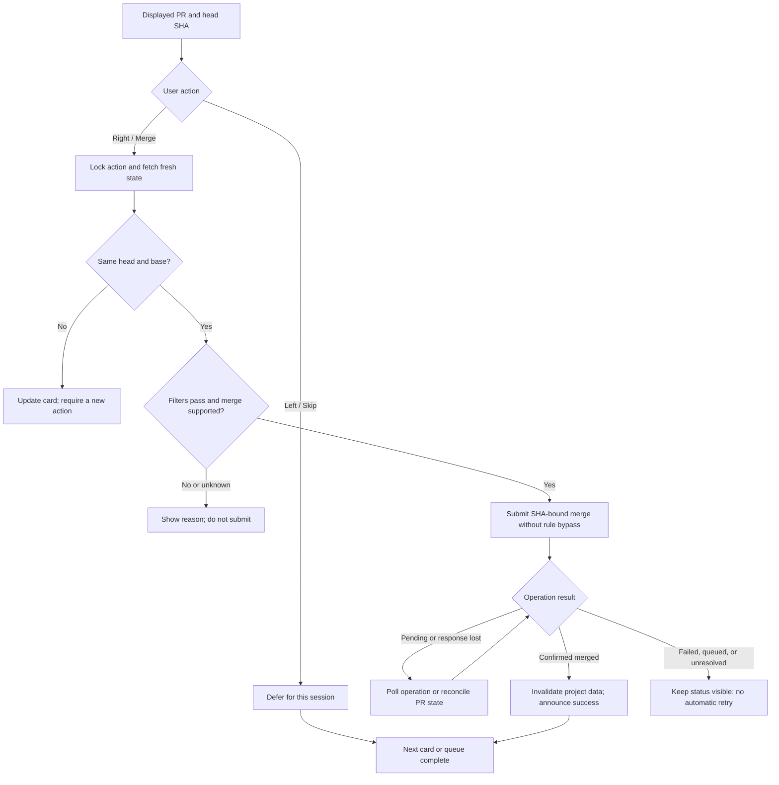

# PR Match: GitHub dashboard and review queue

## Goal and agreed scope

Build a Chrome extension that opens to a simple dashboard of pinned GitHub repositories. A separate review screen presents open pull requests one at a time. Left arrow skips; right arrow submits a merge immediately, without a confirmation dialog.

The extension runs locally and calls GitHub directly. It has no hosted backend. Users connect with fine-grained personal access tokens. Deployment links are discovered through GitHub, with a manual override when needed.

The queue includes all open PRs in connected repositories, regardless of author. Pinning affects the dashboard, not queue coverage. An optional "Authored by me" filter narrows the queue. This corrects the earlier unapproved assumption that only the user's own PRs belonged in the queue.

## Dashboard and navigation

Clicking the toolbar icon opens or focuses the extension tab and selects the dashboard. Navigation contains Projects, Review, and Settings. On first use, show connection setup, then a repository picker for pinning projects. Pins persist in user-defined order and can be removed without affecting GitHub.

Each project card shows:

- Repository owner/name and a link to GitHub.
- A discovered production deployment link or manual URL, with its source and deployment timestamp when available.
- PRs merged today by any author, using the browser's local calendar day.
- Open issues, excluding PRs, and open PR count.
- A Review action that selects this repository in the queue and preserves eligibility filters.
- Last refresh time and any unavailable or stale metrics.

Use a compact card grid with clear counts and one prominent Review action. The review screen centers a single PR card with filters above it and labeled Skip and Merge buttons below it. Both views must work with keyboard navigation, visible focus, screen readers, reduced motion, and WCAG 2.1 AA contrast. Do not rely on color or swipe gestures alone.

An empty dashboard offers Pin project. An empty queue distinguishes no open PRs, no matches, all matching PRs skipped, and data still loading. Each state offers the relevant action: change filters, reset skips, refresh, or repair a connection.

## Account and repository coverage

A connection consists of a token, the authenticated GitHub user ID, and a resource owner. Validate the token with GitHub before storing it. All connections in version one must belong to the same GitHub user. Repository and PR identity use stable GitHub IDs, so renames do not break pins or skips.

Fine-grained tokens are scoped to one resource owner and selected repositories. Support adding owner connections for personal repositories and organizations, then combine and deduplicate their accessible repositories. Label coverage as "Connected repositories"; do not claim to include everything visible in the user's GitHub browser session. Organization approval and outside-collaborator restrictions can limit access. [GitHub token limitations](https://docs.github.com/en/authentication/keeping-your-account-and-data-secure/managing-your-personal-access-tokens)

A repository picker lists repositories discovered for each connection. A connection with partial permissions can still display available dashboard data, while affected metrics and merge actions explain what is missing. Removing a connection deletes its token and cached private data. Retain its pins as disconnected placeholders that can be removed or reconnected.

## Review queue and filters

The PR card includes title, repository/number, author, base/head branches, the displayed head SHA, draft state, description, changed-file/addition/deletion counts, check results, linked closing issues, review decision, and merge readiness. Provide links to the PR and its diff on GitHub. A full inline diff editor is outside version one.

Order the queue by oldest creation time, with repository ID and PR number as stable tie breakers. Keep the active card fixed while more data loads; newly discovered PRs affect subsequent cards. Skipping defers a PR for the current review session and does not change GitHub. Filter changes retain skips; Reset skipped starts the session over. A reopened extension starts a new session.

| Filter | Default | Meaning |
| --- | --- | --- |
| Repository | All connected repositories | Does not depend on dashboard pins. |
| Authored by me | Off | Matches the connected user ID. |
| All CI passing | On | All reported current check runs and commit-status contexts succeed. |
| Linked closing issue | Off | GitHub reports at least one issue this PR would close. |
| Ready to merge | On | The PR has no known merge blocker and can use a supported merge method. |

Settings persist filter choices. Turning off Ready to merge allows inspection of blocked PRs; it never enables merging a blocked PR. Drafts and closed/merged PRs cannot be merged through the extension.

### Exact filter semantics

Evaluate CI for the displayed head SHA using both check runs and legacy commit statuses. Use the latest attempt for each check identity, preserving distinct jobs, apps, and workflows; use the latest status for each context. Follow pagination before declaring the result complete. The individual read endpoints require Checks read and Commit statuses read permissions respectively. [Check runs](https://docs.github.com/en/rest/checks/runs#list-check-runs-for-a-git-reference), [commit statuses](https://docs.github.com/en/rest/commits/statuses#get-the-combined-status-for-a-specific-reference)

The All CI passing filter requires at least one reported check or status and success for every current result. Pending, failure, cancellation, timeout, skipped, neutral, missing access, and incomplete results do not satisfy this strict filter. Show "No checks" separately from "Passing." This policy deliberately implements the user's request for all CI, including optional checks. GitHub's required-check rules remain a separate merge constraint. It cannot account for jobs that have not yet been reported to GitHub.

Use GraphQL `closingIssuesReferences` for the Linked closing issue filter. Label it accurately: ordinary mentions and unrelated cross references do not count. A failed or unauthorized lookup is unknown, not evidence that no issue exists. [GitHub PR schema](https://docs.github.com/en/graphql/reference/pulls#pullrequest)

Conflict-free `mergeable` state alone is insufficient to establish readiness. Check draft/open state, reported merge state, review requirements, repository access, and the allowed merge method. Unresolved or unknown readiness disables merging while allowing refresh and Open in GitHub. Server-side rules remain authoritative.

## Merge contract

Right arrow and the Merge button perform the same action. There is no confirmation dialog and no promised undo. Show the chosen merge method on the button. Default to squash, consistent with the project workflow; allow a per-repository override to another enabled method. If the selected method is unavailable, require an explicit selection instead of silently changing it.

Ignore arrow shortcuts while focus is in an input, select, editable region, or dialog; while modifier keys are pressed; during key repeat; or while the view is not active. Consume a press once and require key release before the next card accepts another arrow action. Disable navigation and mutation controls while a merge is being submitted or its result is unresolved.

For each user action:

1. Capture repository ID, PR number, displayed head SHA, base branch, and selected method. Acquire an operation lock for the extension's review session.
2. Fetch fresh PR state and all data required by active eligibility filters, including linked issues. If the head SHA or base branch changed, replace the card and require a new user action. Do not merge unseen commits.
3. Recheck filters and mandatory readiness. Reject native GitHub stacks and PRs requiring a merge queue in version one; show an Open in GitHub action. A stack merge can affect multiple PRs, which exceeds a single-card action. [GitHub stack behavior](https://docs.github.com/en/pull-requests/reference/stacked-pull-requests-apis-and-webhooks)
4. Submit `PUT /repos/{owner}/{repo}/pulls/{number}/merge-async` with `sha` set to the displayed head SHA, the selected `merge_method`, `merge_action: direct_merge`, and `bypass_rules: false`. Persist the returned operation UUID and poll its result. Acceptance is not completion; only a confirmed `merged` result advances the queue. An `enqueued` result must not be described as merged. GitHub requires Contents write for this endpoint. [GitHub merge API](https://docs.github.com/en/rest/pulls/pulls#merge-a-pull-request-asynchronously)
5. After success, invalidate the affected repo's PR and dashboard data and announce the result. On a definite rejection, keep the card visible with the reason and require a new action to retry.
6. On a timeout, disconnection, worker restart, or duplicate-operation response, reconcile the operation and PR state before permitting another request. Match an existing operation to its PR, SHA, and method before adopting it. Never automatically repeat a merge mutation. Persist enough non-secret operation metadata to recover after reopening the extension. If completion cannot be determined, show "Merge status unknown" with a refresh action. A PR merged by another actor is reported as merged elsewhere, not as this action's success.

A refresh cannot atomically bind CI, linked issues, base-branch changes, or stack membership to a later merge. The SHA condition guards the PR head; GitHub enforces its repository rules during execution. Custom extension filters are checked immediately before submission but can change afterward. Do not claim a stronger guarantee. Projects requiring CI guarantees must enforce them in GitHub branch rules.

## Visual architecture

The service worker opens/focuses the extension tab and owns merge coordination. The UI invokes application services through typed extension messages. GitHub access and storage sit behind small adapters, keeping metrics and filter logic independent of Chrome and network calls.

## Dashboard data and deployment links

| Value | Source and calculation |
| --- | --- |
| Open issues | GraphQL repository `issues(states: OPEN).totalCount`. Do not use REST `open_issues_count`, which includes PRs. |
| Open PRs | Repository PR connection/list restricted to open state, across all authors. |
| Merged today | Count unique merged PRs with `mergedAt` within local midnight inclusive to next local midnight exclusive. Fetch closed PRs ordered by update time descending until crossing the lower bound, then filter actual merge timestamps. Never count merely closed PRs. |
| Deployment | Repository deployments plus each candidate's latest deployment status. Use `environment_url` from that status. |

Compute day boundaries in the browser's time zone, then convert to UTC for comparisons. Recompute at local midnight or a time-zone change; do not assume a day is always 24 hours. Load cards independently, and represent unavailable/incomplete counts as such rather than zero. An interrupted pagination run must not produce a final count.

Deployment resolution follows this order:

1. Use the repository's manual HTTPS URL override if set. Label it "Custom link" and do not imply verified deployment health.
2. Otherwise inspect production deployments: `production_environment: true`, or a non-transient environment named `production` case-insensitively. Allow the user to select a specific non-transient production environment, including custom names such as `live`, and remember it per pin. An explicit selection takes precedence over automatic matching. When several targets match without a selection, ask the user to choose instead of combining unrelated deployments.
3. Read the latest status of each candidate. Choose candidates whose latest state is `success` and whose `environment_url` is valid HTTPS, ordered by that status's creation time, then deployment ID. This accommodates an older build promoted later. An old success followed by `inactive` or `failure` is ineligible. Follow deployment/status pagination and show incomplete resolution if interrupted. The deployment status contains the environment URL; `log_url` and `target_url` can point to build logs. [Deployment statuses](https://docs.github.com/en/rest/deployments/statuses)
4. If a newer production deployment is pending or failed, retain the last eligible successful link with its timestamp and separately show the newer result. If no URL can be established, show "Deployment link unavailable" and offer a manual URL.

This identifies a deployment reported by GitHub, not necessarily the current production alias or custom domain. Vercel may omit records when its GitHub deployment notifications are disabled; a CLI deployment may also have no corresponding GitHub record. Do not derive a guessed URL from the repo name or label the site live without evidence. [Vercel GitHub integration](https://vercel.com/docs/git/vercel-for-github)

## Permissions, storage, and security

Use Manifest V3 with the `storage` permission and host access only to `https://api.github.com/*`. The toolbar action opens a full extension page. There are no content scripts or browsing-history permissions. Opening a deployment or GitHub link is ordinary user navigation and requires no token transfer.

| Fine-grained repository permission | Purpose |
| --- | --- |
| Metadata: read | Repository identity and available metadata. |
| Pull requests: read | PRs, merge state, and details. |
| Issues: read | Issue metrics and linked issue details. |
| Checks: read | Check runs. |
| Commit statuses: read | Legacy CI status contexts. |
| Deployments: read | Deployment records and status URLs. |
| Contents: write, only for merge-enabled connections | Merge endpoint authorization. PR write alone does not authorize merging. |

Validate feature access using actual API responses. GitHub's general token guide and individual endpoint pages currently differ on Checks API support; use the endpoint contract and treat an access failure as unavailable CI, never as passing. [Token guide](https://docs.github.com/en/authentication/keeping-your-account-and-data-secure/managing-your-personal-access-tokens), [check-run endpoint](https://docs.github.com/en/rest/checks/runs#list-check-runs-for-a-git-reference)

Persist tokens and configuration in `chrome.storage.local`, restrict access to trusted extension contexts, and keep tokens out of messages sent to the UI after setup. Do not describe local storage as an encrypted credential vault. Cache private API responses in `chrome.storage.session`, mark them stale after five minutes, bound cache size, and clear them on disconnect or token replacement. Stored data is scoped to user and connection; no Chrome sync. [Chrome storage API](https://developer.chrome.com/docs/extensions/reference/api/storage)

Only the API adapter attaches Authorization headers, and only to validated `api.github.com` requests. Validate pagination URLs and do not forward credentials on external redirects. Never log tokens, headers, PR bodies, or personal account data. Display sanitized error messages without raw response dumps.

Bundle scripts, fonts, and icons locally. Use an extension CSP with self-hosted scripts and API-only connections. Render repository text as text; sanitize any rendered Markdown and disable raw HTML. Validate fetched and user-entered external URLs as HTTPS without embedded credentials. Open them with no opener access. Validate extension message senders and payloads before storage or API operations.

## Implementation and data flow

Use React with strict TypeScript, a static build suitable for Manifest V3, and local component state unless shared state requires coordination. Keep dashboard, review, connection settings, and reusable controls separate. A view error boundary offers retry while retaining saved configuration.

| Module | Responsibility |
| --- | --- |
| Domain | Metrics, day windows, filter evaluation, deployment selection, and merge eligibility with explicit unknown states. |
| Application | Load project cards/queue, select connections, refresh data, and coordinate merge operations. |
| GitHub adapter | REST and GraphQL requests, pagination, response validation, rate limits, and normalized errors. |
| Chrome adapter | Versioned settings, token storage, session cache, toolbar/tab lifecycle, and operation recovery. |
| UI | Render view states and dispatch explicit user actions. |

Keep settings schema-versioned. Persist pins by repository ID with connection ID, display name, sort order, selected deployment environment, and optional URL/method overrides. Represent each API read as a value plus fetch time, completeness, and error state. Keep operation metadata separate from read caches so cache expiry cannot discard an unresolved merge.

Use REST for repository discovery, PR lists/details, checks, statuses, deployments, and merge operations; use GraphQL for issue counts and closing-issue relationships. Prefer repository-scoped pagination over a single global search query so search indexing and result caps do not silently omit PRs. Load pinned cards first; fetch the cross-repository queue when Review opens. Fetch detailed eligibility data for visible candidates with bounded concurrency and show loading progress.

Use ETags where supported, deduplicate reads, and initially cap concurrent reads at four per connection. Read caches are usable for display, never for a merge decision. Refresh stale views when activated and on explicit refresh. Background polling is limited to reconciling a user-requested merge. Honor GitHub's rate-limit/reset and retry headers; pause requests rather than aggressively retrying. Reconnection and permission errors are distinct from rate limiting.

Service worker memory is disposable. Serialize merge submission in the worker and persist operation intent before sending a mutation. After suspension or restart, reconcile outstanding intent/UUID records before releasing the lock. Multiple extension views observe the same operation state. Removing a connection during an unresolved merge must warn that an already submitted server operation cannot be cancelled by deleting the local token.

## Failure behavior

| Situation | Behavior |
| --- | --- |
| Invalid token or organization approval needed | Show a connection-specific repair action; keep other connections usable. |
| Missing issue/deployment/check access | Mark only affected fields unavailable; unknown eligibility cannot pass an enabled filter. |
| Rate limit, offline state, or partial GraphQL errors | Preserve cached values with timestamps and error states; block merge until required fresh data is available. |
| PR changes or closes elsewhere | Refresh the card, or remove it with an explanation. Require another action if the head or base changed. |
| Merge response is lost | Reconcile existing state; never blindly resubmit. |
| Repository renamed, archived, deleted, or inaccessible | Preserve the pin by ID and show updated identity or unavailable state. Disable unsupported writes. |
| Empty/incomplete CI, fork data inaccessible, or unknown merge state | Show the actual state, keep merge unavailable when required data is missing, and link to GitHub. |
| Multiple deployment targets or no production record | Offer environment selection or a manual link instead of silently choosing a preview. |

## Verification and acceptance criteria

Before release, verify the domain rules with focused unit tests and the Chrome/GitHub boundaries with mocked integration tests. Reserve end-to-end coverage for connection, pinning, filtering, and a simulated merge. Live reads need a user-supplied token; any live merge check uses an explicitly designated disposable PR.

1. Toolbar activation opens/focuses the dashboard. Saved pins, order, filters, and overrides survive restart.
2. The queue includes PRs by other authors across connected repos, including unpinned repos. Repository and author filters narrow that set without changing pins.
3. Dashboard counts exclude closed-but-unmerged PRs and exclude PRs from issue counts. Local midnight and daylight-saving transitions produce correct merged-today windows.
4. CI filtering covers both check runs and status contexts, reruns, pagination, optional failures, no checks, neutral/skipped checks, and missing permissions. Unknown data never becomes success.
5. A linked closing issue passes the issue filter; a plain mention does not. Permission failure remains unknown.
6. Merge tests cover changed head/base, disabled methods, drafts, rule rejection, native stacks, required merge queues, and failed preflight reads. No rejected preflight submits a mutation.
7. Held keys, focus in a form, double clicks, competing tabs, worker restart, and lost responses cannot automatically issue another merge. Pending or enqueued is never presented as merged.
8. Deployment tests cover newest success, later inactive status, newer failed/pending deployment, custom environment, multiple targets, missing URLs, and manual override. Build-log and preview URLs are not silently used as production links.
9. Disconnect clears credentials and cached private data for that connection. API errors and logs contain no secrets. Remote content cannot execute code or send a token to another origin.
10. The packaged extension has a valid Manifest V3/CSP, uses only declared permissions, and supports keyboard/screen-reader operation of the primary flows.

These are planned implementation checks; this document review does not establish that the extension exists or has passed them.

## Out of scope for version one

Hosted sign-in, Vercel API access, GitHub Enterprise Server/custom hosts, multiple GitHub identities, native stack merging, merge-queue management, automatic merges triggered without a user action, rule bypass, repository administration, issue editing, full diff review, telemetry, and deployment health probes.

## Decisions and tradeoffs

| Decision | Reason and consequence |
| --- | --- |
| Dashboard first, dedicated review view | Project progress stays visible without crowding the single-PR interaction. |
| Direct GitHub access with owner-scoped tokens | Fits the local requirement; organizations may need separate connections and approvals. |
| All authors by default; pins only affect dashboard | Preserves the requested repository-wide workflow and avoids hiding collaborators' PRs. |
| Strict all-CI filter, separate server merge rules | Matches the requested filter while exposing missing and non-success results honestly. |
| SHA-bound merge with explicit rule-bypass disabled | Protects the displayed head and respects server rules; custom filter checks still have a race window. |
| GitHub deployment discovery with a manual override | Avoids another account connection; cannot guarantee discovery of the live production alias. |
